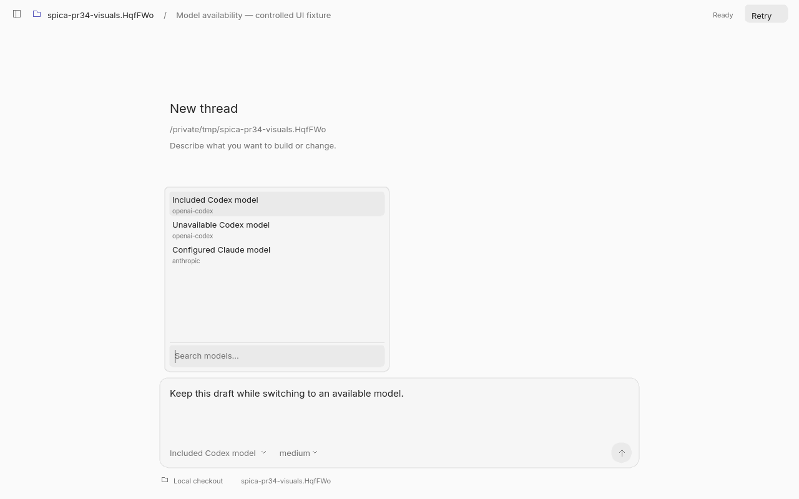
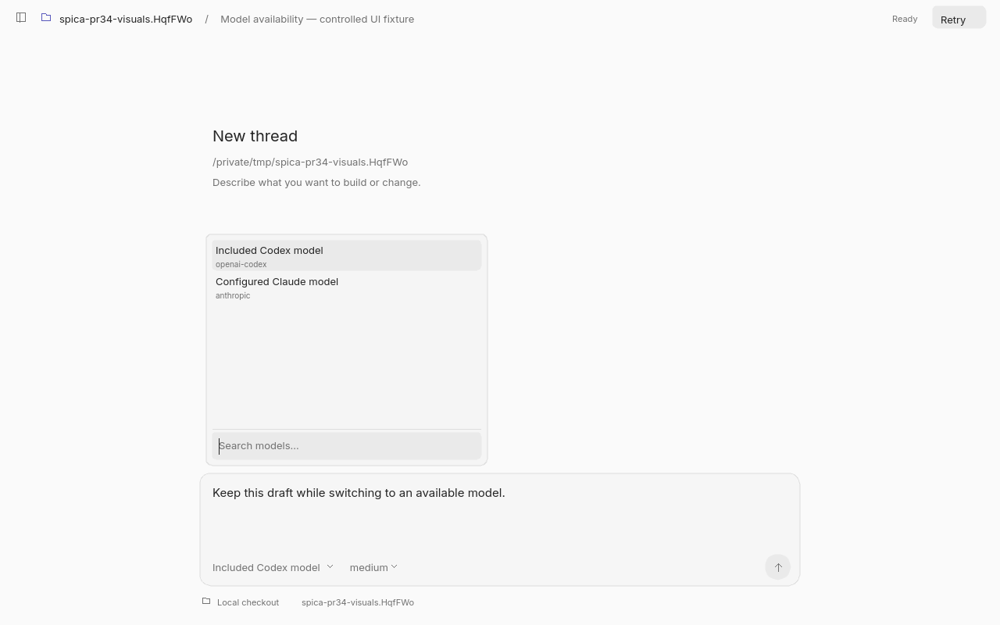
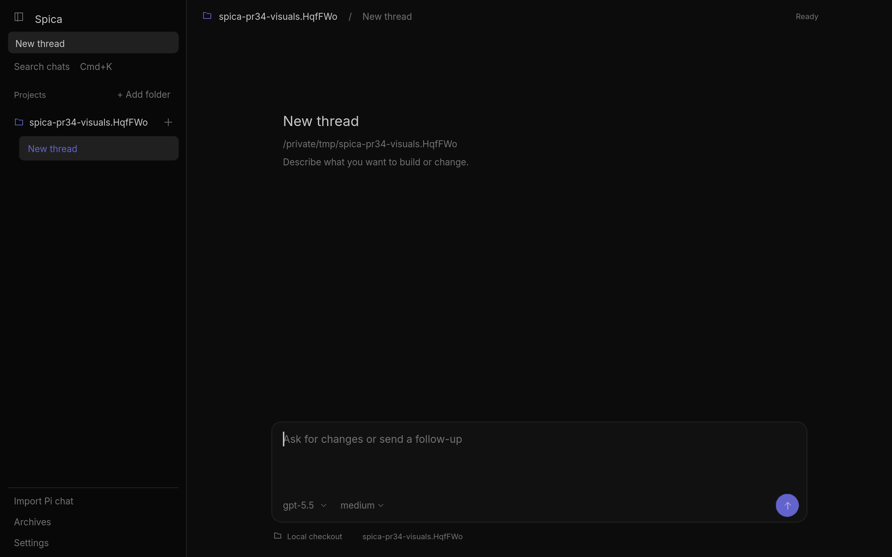

# Model availability visual verification

These screenshots are rendered by Spica's actual SDL software UI on macOS.
They use a controlled catalog fixture, not an account's live subscription or
actual provider model names. No inference request is made by the fixture.

## Configured list before applying the account catalog

The input contains two `openai-codex` models and one `anthropic` model. The draft
is already present before the picker opens.

## Same list after applying the account catalog

The fixture's complete catalog grants access only to `included-codex`.
Spica's production availability filter excludes `outside-subscription` and
retains the unrelated Anthropic model. The picker keeps its selected model and
the composer keeps its draft.

The fixture asserts that exactly two models remain, that Anthropic is retained,
and that the draft is unchanged. This illustrates filtering and picker
rendering; it does not establish which models a real subscription includes.

Separately, a native Cocoa launch with the locally saved Codex login reached
Ready after correcting the URI/TLS initialization path. No model inference
was requested during that check.

